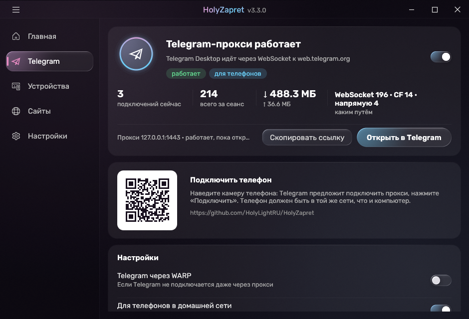
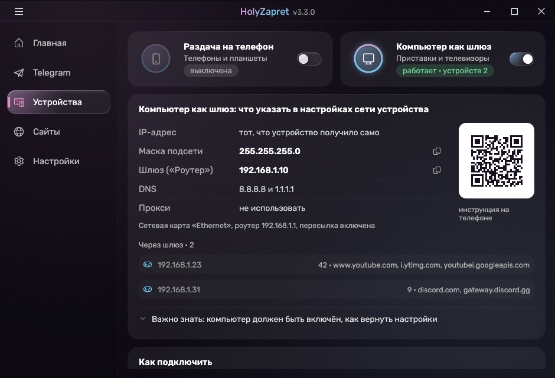

  

<h1 align="center">HolyZapret</h1>
Набор инструментов и экспериментов для обхода интернет-цензуры и ограничений, основанный на оригинальном проекте Zapret, со своим движком обхода RayOfLight. Управляется удобным лаунчером: всё в одном окне, без консоли.

  
  
  

## 🚀 Быстрый старт

1.  Скачайте `Holy-Zapret-X.X.X.zip` из [Releases](https://github.com/HolyLightRU/HolyZapret/releases/latest) и распакуйте в папку без кириллицы и не в OneDrive, например в `C:\HolyZapret`.
2.  Запустите `HolyZapret Launcher.exe`. Он попросит права администратора: без них служба обхода не устанавливается. Если запустили его прямо из архива или из папки с кириллицей, лаунчер сам предложит распаковать или перенести HolyZapret в `C:\HolyZapret`.
3.  Пройдите мастер первой настройки или просто нажмите кнопку на главной: включится защита с движком RayOfLight, который сам подбирает приём обхода для каждого сайта.

## ✨ RayOfLight — свой движок обхода

RayOfLight — собственный движок HolyZapret, написанный на Rust по мотивам zapret. С версии 3.2.1 это единственный движок: старый движок zapret и батники стратегий больше не нужны. RayOfLight обходит сайты из списков, Google и YouTube, HTTP-сайты, голос Discord, «Мои IP» и игры. По проверкам тестеров у разных провайдеров он обходит не хуже и чаще лучше любых стратегий старого движка.

*   **Самоподстройка.** Движок видит, ответил ли сайт, сбросил соединение или промолчал. Если сайт дважды подряд не ответил, движок пробует другой приём и запоминает рабочий для этого сайта. Пока программы молчат, движок сам проверяет такие сайты в фоне. То же самое для QUIC, через который браузеры открывают YouTube, и для игр по UDP при включённом игровом фильтре.
*   **Свой DNS для сайтов из списков.** Если провайдер отвечает, что сайта нет, отказывает или подсовывает заглушку, движок сам спрашивает адрес у шифрованного DNS Google и Cloudflare. Остальные ответы не трогаются, настраивать DNS в Windows не нужно.
*   **Заморозка.** Некоторые провайдеры пропускают начало загрузки с отдельных хостингов, а после 16–20 КБ обрывают её: картинки и файлы грузятся наполовину. Движок замечает такой обрыв, берёт у шифрованного DNS другой адрес сервера, а если и он замолчит, пускает сайт через WARP (если включено «WARP, если не открылось»).
*   **WARP как последний способ.** Если сайт не открылся ни одним приёмом, его можно пустить через Cloudflare WARP: переключатель «WARP, если не открылось» на главной. WARP включается сам, пока такие сайты открыты, и выключается, когда они больше не нужны.
*   **Автосписок.** Если сайт не из списков дважды не ответил, движок сам добавляет его в обход. Список виден в «Настройках» и очищается одной кнопкой.
*   **Обход по программам.** Можно указать программы, весь HTTPS которых идёт через обход, и программы, которые обход не трогает никогда.
*   **Память о том, что работает.** Удачный приём запоминается не только для сайта, но и для его соседей по домену и по серверу, а следующим движок пробует тот приём, который чаще выручал другие сайты. Новые сайты на знакомых серверах открываются сразу, без перебора.
*   **Настройки без перезапуска.** Игровой фильтр, WARP, шлюз и другие переключатели применяются за секунду, служба не перезапускается.
*   **Сторож.** Если движок завис или упал, он сам перезапускает перехват через несколько секунд, а трафик всё это время идёт как обычно.
*   **Всё видно на главной.** Сколько соединений прошло через обход, сколько сайтов ответило и сколько движок подобрал сам, график активности за 30 минут, какие программы и устройства идут через обход и какие сайты не открываются, с кнопкой «Подобрать».

## 🖥 Лаунчер

Всё собрано в пяти разделах: «Главная», «Telegram», «Устройства», «Сайты» и «Настройки». Нажмите на пункт, чтобы прочитать подробнее.

<b>Включение в одно нажатие</b> — нажали старт, служба запускается вместе с Windows

Нажмите кнопку старта на главной: включится RayOfLight с самоподстройкой. Служба запускается вместе с Windows, после установки лаунчер сам проверяет, открываются ли сайты, и перепроверяет недоступные, пока RayOfLight подбирает для них приём.

<b>Подбор приёма</b> — лаунчер сравнит приёмы RayOfLight на Discord, YouTube и ваших сайтах

Кнопка «Подобрать приём» на вкладке «Сайты». Лаунчер по очереди запускает RayOfLight с самоподстройкой и с каждым приёмом отдельно и проверяет Discord, YouTube, Google, хостинги, WARP и ваши сайты, в том числе на «заморозку» соединения после 16–20 КБ, и соединение с голосовыми серверами Discord ваших регионов. Хостинги, которые не обходит ни один приём, не портят счёт. Можно подобрать приём и только под свой сайт: впишите ссылку, и если сайт заблокирован, его домен сам попадёт в списки обхода. Лучший приём ставится в один клик: служба работает с самоподстройкой, а найденный приём идёт первым шагом. Подробный отчёт о подборе можно сохранить на рабочий стол.

<b>Проверка сайтов</b> — какие сайты открываются и с какой задержкой

Вкладка «Сайты» показывает, какие сайты открываются и с какой задержкой, а сразу под проверкой — подбор приёма. Сначала видны только недоступные сайты, весь список — по кнопке «Все». Можно добавить свои сайты: они попадут и в проверку, и в подбор.

<b>Правила для сайтов</b> — сразу правильный приём для сайта, который не открывается

Если какой-то сайт не открывается, кнопка «Подобрать» проверит его без обхода, а потом по очереди с приёмами RayOfLight, пока сайт не откроется. Найденный приём запоминается для сайта и доменов, с которых он грузит картинки и скрипты, например CDN Steam, и сразу передаётся самоподстройке. Если позже сайт перестанет отвечать, самоподстройка подберёт приём заново. Недоступный сайт из проверки на вкладке «Сайты» можно отправить в подбор одной кнопкой или подобрать сразу для всех недоступных. Сайт, который обход ломает, лаунчер предложит не обходить. Все правила можно перепроверить одной кнопкой: лаунчер покажет, какие работают, какие больше не нужны, а какие пора подобрать заново.

<b>Раздача на телефон</b> — обход для телефона, телевизора и приставки через компьютер

Телефоны и другие устройства в вашей сети получают обход HolyZapret через компьютер, без root и VPN-серверов. Наведите камеру на QR-код на вкладке «Устройства»: откроется страница с пошаговой настройкой для Android, iPhone, телевизоров с Android TV и PlayStation. Через приложение v2rayNG на телефон идёт всё, включая звонки Discord: сервер добавляется по QR-коду из лаунчера. Работает, пока компьютер включён и лаунчер открыт. Если телефон не подключается, раздел «Телефон не подключается?» на той же вкладке найдёт, что мешает: тип сети, брандмауэр Windows, антивирус или VPN, и многое исправит сама. В карточке раздачи видно, что запрашивает каждое устройство и какие были ошибки.

<b>Компьютер как шлюз</b> — обход для приставок и телевизоров, где прокси не помогает

Некоторые приложения не используют прокси: например, приложение YouTube на PlayStation 5. Для них есть режим «Компьютер как шлюз» на вкладке «Устройства»: в настройках сети устройства этот компьютер указывается как шлюз, и всё, что открывает устройство, идёт через обход RayOfLight, а самому устройству прокси не нужен. Лаунчер показывает, что вписать в устройство, а QR-код открывает на телефоне пошаговую настройку для PlayStation 5 и 4, Xbox, Nintendo Switch, телевизоров и телефонов Android. Через шлюз работают приложение YouTube на PS5, Discord и всё остальное. Компьютер должен быть включён, а его адрес в сети лучше закрепить в настройках роутера.

<b>Код настройки для друга</b> — вся ваша настройка в одном коде

Вариант RayOfLight, свои домены и IP, правила для сайтов и игровой фильтр упаковываются в один код. Друг вставляет его в «Настройки → Код от друга», видит, что внутри, и выбирает, что взять.

<b>Слежение за обходом</b> — уведомит, если обход перестал работать

Раз в 20 минут лаунчер проверяет YouTube и Discord. Если провайдер что-то поменял и обход перестал работать, придёт уведомление, а на главной появится кнопка «Подобрать и поставить»: лаунчер сам проверит приёмы RayOfLight и поставит лучший вариант, если он лучше текущего. В настройках можно разрешить делать это без вас, когда компьютером никто не пользуется.

<b>Диагностика</b> — найдёт, что мешает обходу, и исправит кнопкой

Находит то, что мешает обходу: выключенные TCP timestamps, конфликтующие программы и VPN, другие обходы, службу zapret из другой папки, забытый драйвер WinDivert, кириллицу в пути, сервисы вроде Steam или банков в «Моих доменах», которым обход не нужен. Большинство проблем исправляется кнопкой. Если сам лаунчер закроется с ошибкой, при следующем запуске он предложит сохранить отчёт с местом ошибки для разработчика.

<b>Проверка программы</b> — покажет, трогает ли обход трафик конкретной игры или программы

В «Настройках → Диагностика → Программа» выберите игру или программу (или «Любая программа», если она ещё не запущена), и лаунчер запишет, куда она подключается, и показывает по каждому адресу и порту, трогает ли его обход. Если не трогает, подскажет почему: выключен игровой фильтр или адреса нет в «Моих IP», и исправит одной кнопкой. Программу, которая ломается от обхода, можно исключить.

<b>Telegram-прокси</b> — ускоряет Telegram Desktop без сторонних серверов

Ускоряет Telegram Desktop: трафик идёт через WebSocket к серверам web.telegram.org, без сторонних серверов. Встроен прямо в лаунчер, подключается к Telegram одной кнопкой и работает, пока лаунчер открыт или свёрнут в трей. Если на компьютере есть Telegram Desktop, для прокси появляется отдельная вкладка. Если в вашем регионе Telegram не подключается даже через прокси, включите «Telegram через WARP»: трафик Telegram пойдёт через Cloudflare WARP, а всё остальное как обычно через обход. Прокси можно открыть и для телефонов в домашней сети: наведите камеру телефона на QR-код в карточке прокси, и Telegram на телефоне пойдёт тем же путём, что и на компьютере, без VPN и лишних приложений.

<b>Cloudflare WARP</b> — WARP поверх защиты прямо из лаунчера

Включайте WARP поверх защиты прямо из лаунчера: весь трафик, только DNS 1.1.1.1 или локальный прокси для отдельных программ.

<b>Свои списки</b> — свои домены и IP для обхода и исключений

В продвинутом режиме можно добавлять домены и IP в списки обхода и исключений, а также найти домены и IP сайта по ссылке на него.

<b>Трей и автозапуск</b> — включение и выключение защиты из трея

Лаунчер сворачивается в трей, иконка показывает, работает ли защита. Левый клик по иконке открывает небольшое окошко: кнопка защиты, сводка за 10 минут и переключатели игрового фильтра, WARP и Telegram-прокси. Правый клик — короткое меню. По желанию лаунчер запускается вместе с Windows.

<b>Обновления</b> — одной кнопкой или сами в фоне, с проверкой архива

Когда выходит новая версия, лаунчер сам предложит обновиться и покажет ход загрузки. Обновление ставится одной кнопкой, не выключая защиту, а лаунчер сам перезапускается. Если загрузка с GitHub обрывается, лаунчер докачивает файл с того же места. Ваши списки, игровой фильтр и правила при этом не трогаются, а после обновления лаунчер покажет, что нового. Перед установкой лаунчер сверяет хеш SHA-256 архива с опубликованным в релизе, поэтому повреждённый или подменённый архив не встанет. Если включить «Обновлять самому», лаунчер в трее сам поставит новую версию, когда компьютером 10 минут не пользуются, и сообщит об этом уведомлением Windows.

<b>Сброс</b> — вернуть свои списки и настройки к исходным

Если что-то натыкали и сломали, в настройках есть «Сбросить мои настройки и списки»: свои домены, IP, правила и настройки вернутся к исходным.

## ⚡️ Возможности

*   **Свой движок RayOfLight:** Самоподстройка приёма для каждого сайта, автосписок, обход по программам и режим «Компьютер как шлюз» для приставок.
*   **Восстановление работы Roblox:** Домены Roblox (сайт, вход, загрузка игр) есть в общем списке обхода. Если сама игра не подключается, включите игровой фильтр и проверьте Roblox в лаунчере в «Настройках → Диагностика → Программа»: он покажет, трогает ли обход её серверы, и добавит их адреса одной кнопкой.
*   **Игровой фильтр:** Обход для игр и других программ на нестандартных портах, с отдельными диапазонами для TCP и UDP.
*   **Proxy Hosts System:** Система на основе файла `hosts` для доступа к заблокированным сайтам (например, chatgpt.com, open.spotify.com) и обхода ограничений TikTok без VPN. Обновляется в лаунчере (Настройки → Файл hosts) или через `scripts\holy_host_system.bat`. Список сервисов находится в `\lists\hosts-list.txt`.

## 🔗 Ссылки

*   **С чего всё началось:** [Flowseal/zapret-discord-youtube](https://github.com/Flowseal/zapret-discord-youtube), из стратегий которого вырос HolyZapret.
*   **Telegram-прокси:** [Flowseal/tg-ws-proxy](https://github.com/Flowseal/tg-ws-proxy). Встроенный прокси повторяет его работу на Rust, огромное спасибо за проект! 🩷
*   **zapret:** [bol-van/zapret](https://github.com/bol-van/zapret). Идеи и приёмы zapret легли в основу RayOfLight.
*   **Драйвер перехвата:** [basil00/WinDivert](https://github.com/basil00/WinDivert), через него работает RayOfLight.

## 📄 Лицензия

HolyZapret распространяется под лицензией [GNU GPL v3](LICENSE): им можно свободно пользоваться, изменять и распространять, но изменённые версии должны оставаться открытыми под той же лицензией.

Приёмы обхода основаны на [zapret](https://github.com/bol-van/zapret) (bol-van) и [zapret-discord-youtube](https://github.com/Flowseal/zapret-discord-youtube) (Flowseal) под лицензией MIT, драйвер [WinDivert](https://github.com/basil00/WinDivert) — под LGPL v3, шрифт [Rubik](https://github.com/googlefonts/rubik) — под SIL Open Font License. Полный список сторонних компонентов и их лицензий — в [THIRD-PARTY-NOTICES.txt](THIRD-PARTY-NOTICES.txt).

---
Создано с любовью. Проект некоммерческий: без рекламы, подписок и платных функций. 🩷

