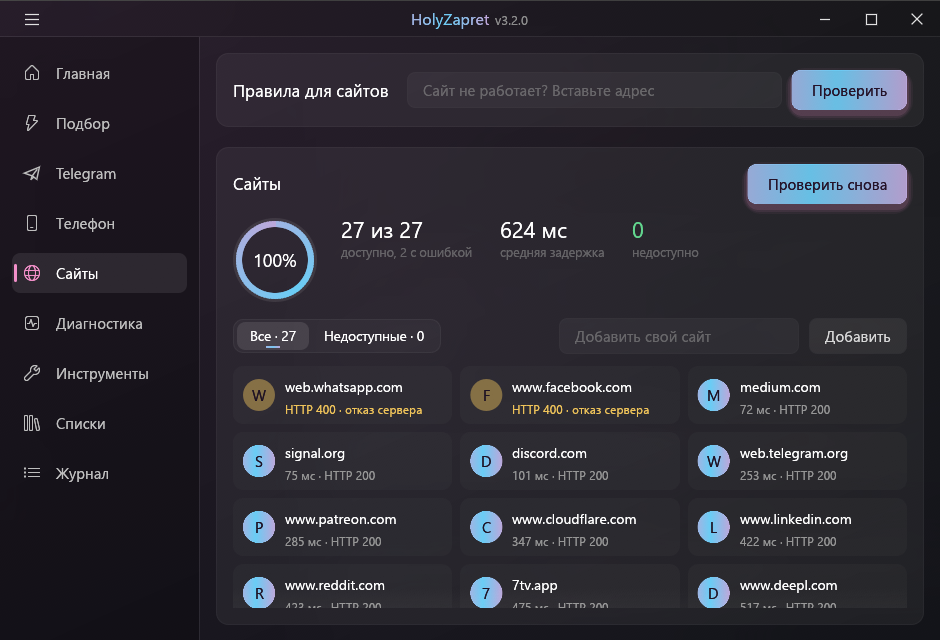
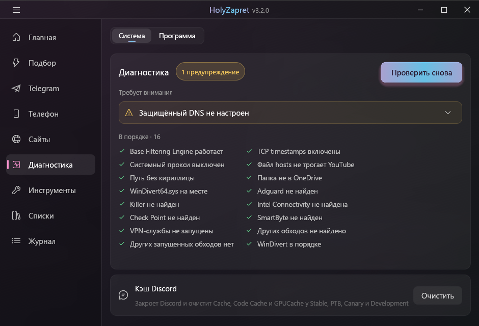

  

<h1 align="center">HolyZapret</h1>
Набор инструментов и экспериментов для обхода интернет-цензуры и ограничений, основанный на оригинальном проекте Zapret. Управляется удобным лаунчером: всё в одном окне, без консоли.

  
  
  

## 🚀 Быстрый старт

1.  Скачайте `Holy-Zapret-X.X.X.zip` из [Releases](https://github.com/HolyLightRU/HolyZapret/releases/latest) и распакуйте в папку без кириллицы и не в OneDrive, например в `C:\HolyZapret`.
2.  Запустите `HolyZapret Launcher.exe`. Он попросит права администратора: без них служба обхода не устанавливается. Если запустили его прямо из архива или из папки с кириллицей, лаунчер сам предложит распаковать или перенести HolyZapret в `C:\HolyZapret`.
3.  Пройдите мастер первой настройки: диагностика, подбор стратегии и установка за три шага.

Привычный `manager.bat` никуда не делся, им по-прежнему можно пользоваться.

## 🖥 Лаунчер

Нажмите на пункт, чтобы прочитать подробнее.

<b>Включение в одно нажатие</b> — выбрали стратегию, нажали старт, служба запускается вместе с Windows

Выберите стратегию и нажмите кнопку старта. Служба запускается вместе с Windows, после установки лаунчер сам проверяет, открываются ли сайты.

<b>Подбор стратегии</b> — лаунчер сам проверит стратегии на Discord, YouTube и ваших сайтах и поставит лучшую

Лаунчер по очереди запускает стратегии и проверяет Discord, YouTube, Google, хостинги, WARP и ваши сайты, в том числе на «заморозку» соединения после 16–20 КБ, и соединение с голосовыми серверами Discord ваших регионов. Хостинги, которые стратегия не обходит, не портят ей счёт. Можно подобрать стратегию и только под свой сайт: впишите ссылку, и если сайт заблокирован, его домен сам попадёт в списки обхода. Набор «Эксперимент» проверяет варианты general, в каждом из которых изменена одна настройка: вдруг у вашего провайдера какой-то из них работает лучше. Лучшая стратегия ставится в один клик, а результаты последнего подбора видны на главной: подходящие стратегии сверху. Подробный отчёт о подборе сохраняется на рабочий стол.

<b>Пробный запуск</b> — стратегию можно попробовать без установки службы

Попробуйте стратегию без установки службы. Если не подошла, остановите её, и всё вернётся как было.

<b>Стратегии Flowseal</b> — оригинальные стратегии скачиваются и обновляются из лаунчера

Оригинальные стратегии Flowseal скачиваются и обновляются из лаунчера и работают со своим движком, не мешая стратегиям HolyZapret.

<b>Проверка сайтов</b> — какие сайты открываются и с какой задержкой

Показывает, какие сайты открываются и с какой задержкой. Можно добавить свои сайты: они попадут и в проверку, и в подбор.

<b>Правила для сайтов</b> — отдельный приём обхода для сайта, который не работает на вашей стратегии

Если какой-то сайт не работает, лаунчер проверит его без обхода и со стратегией. Правило сразу охватывает домены, с которых сайт грузит картинки и скрипты, например CDN Steam. Недоступный сайт из проверки на вкладке «Сайты» можно отправить в подбор одной кнопкой «Подобрать» или подобрать правила сразу для всех недоступных. Он подскажет не обходить сайт, который стратегия ломает, или подберёт для него отдельный приём обхода. Если встроенные приёмы не помогли, лаунчер попробует профили других стратегий. А если в подборе часть сайтов открывается только на другой стратегии, лаунчер предложит собрать: оставить свою стратегию для всего, а эти сайты пустить через профиль той, на которой они работают. Правило ставится одной кнопкой и работает с любой стратегией. После смены стратегии все правила можно перепроверить одной кнопкой: лаунчер покажет, какие работают, какие больше не нужны, а какие пора подобрать заново.

<b>Раздача на телефон</b> — обход для телефона, телевизора и приставки через компьютер

Телефоны и другие устройства в вашей сети получают обход HolyZapret через компьютер, без root и VPN-серверов. Наведите камеру на QR-код на вкладке «Телефон»: откроется страница с пошаговой настройкой для Android, iPhone, телевизоров с Android TV и PlayStation. Через приложение v2rayNG на телефон идёт всё, включая звонки Discord: сервер добавляется по QR-коду из лаунчера. Работает, пока компьютер включён и лаунчер открыт. Если телефон не подключается, кнопка «Проверить» на той же вкладке найдёт, что мешает: тип сети, брандмауэр Windows, антивирус или VPN, и многое исправит сама.

<b>Код настройки для друга</b> — вся ваша настройка в одном коде

Стратегия, свои домены и IP, правила для сайтов и игровой фильтр упаковываются в один код. Друг вставляет его в «Настройки → Код от друга», видит, что внутри, и выбирает, что взять.

<b>Слежение за обходом</b> — уведомит, если обход перестал работать, и поможет подобрать новую стратегию

Раз в 20 минут лаунчер проверяет YouTube и Discord. Если провайдер что-то поменял и обход перестал работать, придёт уведомление, а на главной появится кнопка «Подобрать и поставить»: лаунчер сам проверит быстрый набор стратегий и поставит лучшую, если она лучше текущей. В настройках можно разрешить делать это без вас, когда компьютером никто не пользуется.

<b>Диагностика</b> — найдёт, что мешает обходу, и исправит кнопкой

Находит то, что мешает обходу: выключенные TCP timestamps, конфликтующие программы и VPN, другие обходы, службу оригинального zapret, забытый драйвер WinDivert, кириллицу в пути, сервисы вроде Steam или банков в «Моих доменах», которым обход не нужен. Большинство проблем исправляется кнопкой. Если сам лаунчер закроется с ошибкой, при следующем запуске он предложит сохранить отчёт с местом ошибки для разработчика.

<b>Проверка программы</b> — покажет, трогает ли обход трафик конкретной игры или программы

На вкладке «Диагностика → Программа» выберите игру или программу (или «Любая программа», если она ещё не запущена), и лаунчер запишет, куда она подключается, и показывает по каждому адресу и порту, трогает ли его обход. Если не трогает, подскажет почему: выключен игровой фильтр или адреса нет в «Моих IP», и исправит одной кнопкой. Программу, которая ломается от обхода, можно исключить.

<b>Telegram-прокси</b> — ускоряет Telegram Desktop без сторонних серверов

Ускоряет Telegram Desktop: трафик идёт через WebSocket к серверам web.telegram.org, без сторонних серверов. Встроен прямо в лаунчер, подключается к Telegram одной кнопкой и работает, пока лаунчер открыт или свёрнут в трей. Если на компьютере есть Telegram Desktop, для прокси появляется отдельная вкладка. Если в вашем регионе Telegram не подключается даже через прокси, включите «Telegram через WARP»: трафик Telegram пойдёт через Cloudflare WARP, а всё остальное как обычно через обход.

<b>Cloudflare WARP</b> — WARP поверх защиты прямо из лаунчера

Включайте WARP поверх защиты прямо из лаунчера: весь трафик, только DNS 1.1.1.1 или локальный прокси для отдельных программ.

<b>Свои списки</b> — свои домены и IP для обхода и исключений

В продвинутом режиме можно добавлять домены и IP в списки обхода и исключений, а также найти домены и IP сайта по ссылке на него.

<b>Трей и автозапуск</b> — включение и выключение защиты из трея

Лаунчер сворачивается в трей, иконка показывает, работает ли защита, а включить и выключить её можно прямо из меню. По желанию лаунчер запускается вместе с Windows.

<b>Обновления</b> — одной кнопкой или сами в фоне, с проверкой архива

Когда выходит новая версия, лаунчер сам предложит обновиться и покажет ход загрузки. Обновление ставится одной кнопкой, не выключая защиту, а лаунчер сам перезапускается. Если загрузка с GitHub обрывается, лаунчер докачивает файл с того же места. Ваши списки, игровой фильтр, правила и стратегии Flowseal при этом не трогаются, а после обновления лаунчер покажет, что нового. Перед установкой лаунчер сверяет хеш SHA-256 архива с опубликованным в релизе, поэтому повреждённый или подменённый архив не встанет. Если включить «Обновлять самому», лаунчер в трее сам поставит новую версию, когда компьютером 10 минут не пользуются, и сообщит об этом уведомлением Windows.

<b>Сброс</b> — вернуть свои списки и настройки к исходным

Если что-то натыкали и сломали, в настройках есть «Сбросить мои настройки и списки»: свои домены, IP, правила и настройки вернутся к исходным.

## ⚡️ Возможности

*   **Различные стратегии обхода:** Собственные разработки (смотрите папку `additional`) и стратегии из оригинального репозитория, которые лаунчер скачивает сам.
*   **Фикс звонков в Telegram через Zapret:** Работает в general.bat и auto_update.bat, требует наличие подобного фикса у второго собеседника.
*   **Восстановление работы Roblox:** Домены Roblox (сайт, вход, загрузка игр) есть в общем списке обхода. Если сама игра не подключается, включите игровой фильтр и проверьте Roblox в лаунчере на вкладке «Диагностика → Программа»: он покажет, трогает ли обход её серверы, и добавит их адреса одной кнопкой.
*   **Игровой фильтр:** Обход для игр и других программ на нестандартных портах, с отдельными диапазонами для TCP и UDP.
*   **Proxy Hosts System:** Система на основе файла `hosts` для доступа к заблокированным сайтам (например, chatgpt.com, open.spotify.com) и обхода ограничений TikTok без VPN. Обновляется в лаунчере (Инструменты → Файл hosts) или через `holy_host_system.bat`. Список сервисов находится в `\lists\hosts-list.txt`.

## 🔗 Ссылки

*   **Оригинальный репозиторий:** [Flowseal/zapret-discord-youtube](https://github.com/Flowseal/zapret-discord-youtube)
*   **Telegram-прокси:** [Flowseal/tg-ws-proxy](https://github.com/Flowseal/tg-ws-proxy). Встроенный прокси повторяет его работу на Rust, огромное спасибо за проект! 🩷
*   **Движок:** [bol-van/zapret](https://github.com/bol-van/zapret), на котором построено всё остальное.

## 📄 Лицензия

HolyZapret распространяется под лицензией [GNU GPL v3](LICENSE): им можно свободно пользоваться, изменять и распространять, но изменённые версии должны оставаться открытыми под той же лицензией.

Движок и стратегии основаны на [zapret](https://github.com/bol-van/zapret) (bol-van) и [zapret-discord-youtube](https://github.com/Flowseal/zapret-discord-youtube) (Flowseal) под лицензией MIT, драйвер [WinDivert](https://github.com/basil00/WinDivert) и `cygwin1.dll` — под LGPL v3. Полный список сторонних компонентов и их лицензий — в [THIRD-PARTY-NOTICES.txt](THIRD-PARTY-NOTICES.txt).

---
Создано с любовью. Проект некоммерческий: без рекламы, подписок и платных функций. 🩷

