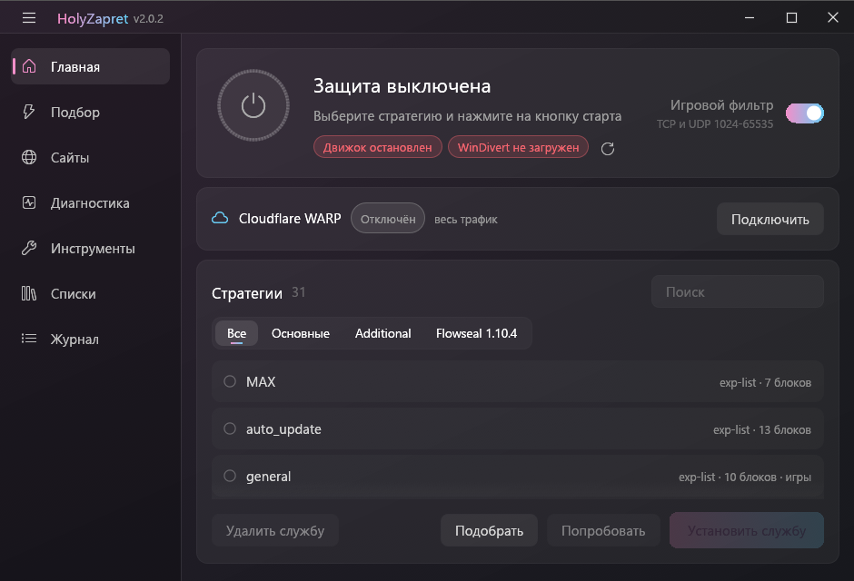

  

<h1 align="center">HolyZapret</h1>
Набор инструментов и экспериментов для обхода интернет-цензуры и ограничений, основанный на оригинальном проекте Zapret. Управляется удобным лаунчером: всё в одном окне, без консоли.

  
  
  

## 🚀 Быстрый старт

1.  Скачайте `Holy-Zapret-X.X.X.zip` из [Releases](https://github.com/HolyLightRU/HolyZapret/releases/latest) и распакуйте в папку без кириллицы и не в OneDrive, например в `C:\HolyZapret`.
2.  Запустите `HolyZapret Launcher.exe`. Он попросит права администратора: без них служба обхода не устанавливается.
3.  Пройдите мастер первой настройки: диагностика, подбор стратегии и установка за три шага.

Привычный `manager.bat` никуда не делся, им по-прежнему можно пользоваться.

## 🖥 Лаунчер

*   **Включение в одно нажатие:** Выберите стратегию и нажмите кнопку старта. Служба запускается вместе с Windows, после установки лаунчер сам проверяет, открываются ли сайты.
*   **Подбор стратегии:** Лаунчер по очереди запускает стратегии и проверяет Discord, YouTube, Google, хостинги, WARP и ваши сайты, в том числе на «заморозку» соединения после 16–20 КБ. Лучшая стратегия ставится в один клик, а результаты последнего подбора видны на главной: подходящие стратегии сверху.
*   **Пробный запуск:** Попробуйте стратегию без установки службы. Если не подошла, остановите её, и всё вернётся как было.
*   **Стратегии Flowseal:** Оригинальные стратегии Flowseal скачиваются и обновляются из лаунчера и работают со своим движком, не мешая стратегиям HolyZapret.
*   **Проверка сайтов:** Показывает, какие сайты открываются и с какой задержкой. Можно добавить свои сайты: они попадут и в проверку, и в подбор.
*   **Диагностика:** Находит то, что мешает обходу: выключенные TCP timestamps, конфликтующие программы и VPN, другие обходы, службу оригинального zapret, забытый драйвер WinDivert. Большинство проблем исправляется кнопкой.
*   **Cloudflare WARP:** Включайте WARP поверх защиты прямо из лаунчера: весь трафик, только DNS 1.1.1.1 или локальный прокси для отдельных программ.
*   **Свои списки:** В продвинутом режиме можно добавлять домены и IP в списки обхода и исключений, а также найти домены и IP сайта по ссылке на него.
*   **Трей и автозапуск:** Лаунчер сворачивается в трей, иконка показывает, работает ли защита, а включить и выключить её можно прямо из меню. По желанию лаунчер запускается вместе с Windows.
*   **Обновления:** Новая версия HolyZapret ставится из лаунчера одной кнопкой. Ваши списки, игровой фильтр и стратегии Flowseal при этом не трогаются.

## ⚡️ Возможности

*   **Различные стратегии обхода:** Собственные разработки (смотрите папку `additional`) и стратегии из оригинального репозитория, которые лаунчер скачивает сам.
*   **Фикс звонков в Telegram через Zapret:** Работает в general.bat и auto_update.bat, требует наличие подобного фикса у второго собеседника.
*   **Восстановление работы Roblox:**
*   **Игровой фильтр:** Обход для игр и других программ на нестандартных портах, с отдельными диапазонами для TCP и UDP.
*   **Proxy Hosts System:** Система на основе файла `hosts` для доступа к заблокированным сайтам (например, chatgpt.com, open.spotify.com) и обхода ограничений TikTok без VPN. Обновляется в лаунчере (Инструменты → Файл hosts) или через `holy_host_system.bat`. Список сервисов находится в `\lists\hosts-list.txt`.

## 🔗 Ссылки

*   **Оригинальный репозиторий:** [Flowseal/zapret-discord-youtube](https://github.com/Flowseal/zapret-discord-youtube)

---
Создано с любовью. Не претендую ни на что. 🩷

